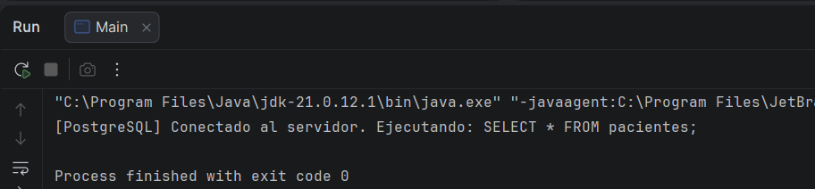

- Diseño de Software - Módulo 3
- Ejercitación - Patrón Factory Method
Ejercicio 2: Creador de Conexiones a Motores de Base de Datos
Contexto del problema:
Un software de administración de bases de datos debe conectarse opcionalmente a diferentes motores (como SQLite o PostgreSQL) dependiendo de los parámetros configurados por el usuario, requiriendo un punto de creación unificado.

Objetivo de aprendizaje:
Aplicar el patrón Factory Method para encapsular la lógica de selección y construcción de objetos con interfaces similares pero comportamientos subyacentes distintos.

Requisitos funcionales:

Proveer una interfaz de conexión genérica que declare métodos para ejecutar consultas de prueba.

Implementar creadores específicos para cada motor de base de datos que devuelvan su respectivo conector configurado.

Restricciones técnicas:

La lógica que decide qué creador instanciar debe estar separada de la lógica de negocio que utiliza la conexión.

Cada creador concreto debe sobrescribir el método de fábrica de la clase base para retornar la conexión adecuada.
***
# Lógica y Funcionamiento del Programa:
    Para resolver este ejercicio apliqué el patrón Factory Method para que la aplicación pueda cambiar de base de datos sin tener que andar modificando el código donde se ejecutan las consultas.

- Interfaz Conexion: Define el método probarConsulta() para que todos los motores se usen de la misma manera.

- Clases ConexionSQLite y ConexionPostgres: Implementan la interfaz y simulan la conexión y ejecución de una consulta según el comportamiento de cada motor.

- Clase FabricaConexion: Es la clase abstracta base que tiene el método de fábrica crearConexion() y un método general para correr la prueba.

- Clases FabricaSQLite y FabricaPostgres: Son las fábricas específicas. Cada una sobrescribe el método de la clase base para devolver la instancia de su motor correspondiente.

- Clase Main: Para cumplir con las restricciones, separé la decisión de qué fábrica instanciar en un método aparte (obtenerFabrica) que lee un parámetro de configuración. De esa forma, la parte principal del programa simplemente recibe la fábrica lista y ejecuta la consulta sin importar qué base de datos hay por detrás.
***
# Ejecucion por consola
